# System architecture

## Scope

The implemented reconstruction path is Model 1 punctuation restoration followed by Model 2 sentence ordering. Model 3 translation is evaluated as a separate post-processing experiment; `src/pipeline.py` does not call the translation script.

```mermaid
flowchart LR
    A[UTF-8 raw Hindi file] --> B[Whitespace and NULL cleanup]
    B --> C[Model 1 token classification]
    C --> D[Punctuated Hindi file]
    D --> E[Sentence segmentation and IDs]
    E --> F[MiniLM sentence embeddings]
    F --> G[Adjacent cosine-affinity search]
    G --> H[Ordered Hindi text and mapping]
    H -. optional separate experiment .-> I[IndicTrans2 + IndicTransToolkit]
    I --> J[English output and JSONL manifest]
    J --> K[UNVALIDATED; candidate rejected for final-quality use]
```

## Components and files

| Component | Implementation | Inputs | Outputs |
|---|---|---|---|
| Model 1 example | `src/punctuation_test.py` | Embedded short Hindi example | `outputs/punctuated_test.txt` |
| Model 1 batch runner | `src/run_on_dataset.py` | All `data/*.txt` files | `outputs/<stem>_punctuated.txt` |
| Model 1 evaluation | `evaluation/evaluate.py` | 55 provisional references and cached/generated model predictions | `evaluation/reports/`, predictions cache |
| Model 2 | `src/model2_ordering.py` | Punctuated files, segmented sentence strings | Ordered text, sentence mapping, run reports under `outputs/model2_ordering/` |
| Reconstruction orchestration | `src/pipeline.py` | Raw input files; optionally reuses `outputs/<stem>_punctuated.txt` | Punctuated files plus `outputs/pipeline_final/` outputs and reports |
| Model 3 experiment | `scripts/test_model3_indictrans2.py` | UTF-8, one sentence per line | JSON and optional English text; seven full-run outputs and manifest live under `outputs/translation/indictrans2/` |

## Data flow and identity

The seven raw inputs are `data/sample-1.txt` through `data/sample-7.txt`. Model 1 replaces literal `NULL` placeholders with whitespace and normalizes whitespace before calling the publisher's punctuation helper. Model 2 segments the punctuated text on newlines or whitespace after `।`, `?`, and `!`. It assigns IDs such as `sample-1_S001`, stores original and predicted positions in JSONL mappings, and builds output from the original sentence strings indexed by the predicted permutation.

The Model 2 integrity checker compares sentence multiplicities before and after ordering. This can establish that no segmented sentence was dropped, duplicated, or rewritten; it cannot establish that an order is correct. For the seven corpus files, the recorded MiniLM counts were 49, 49, 47, 50, 52, 45, and 52.

Model 3 is run on an ordered file separately, with a group size of five by default. It uses `hin_Deva` and `eng_Latn`, keeps sentence order, and writes sentence-level records containing sample/index/group/source/output fields. The 344-record full run is **UNVALIDATED**. It is not wired into the main pipeline.

## Ordering methods

The selected practical method uses the 384-dimensional multilingual MiniLM sentence encoder and symmetric cosine similarity. MiniLM scores adjacent candidate pairs while search constructs a permutation. For up to eight sentences the implementation examines all permutations; above eight it uses beam search (default width 64). A separate mBERT next-sentence-prediction method computes directional transition scores and is available for comparison. `src/pipeline.py` defaults to `compare`; use `--method minilm` to run only the selected practical MiniLM method.

## Output locations

- `outputs/`: punctuated corpus files and the Model 1 demonstration output.
- `outputs/model2_ordering/`: ordering method outputs, sentence mappings, pairwise NSP scores, and run summaries.
- `outputs/pipeline_final/`: combined Model 1–2 reconstructed Hindi results.
- `outputs/translation/`: preserved Helsinki and M2M100 experiments plus IndicTrans2 pilot, report, benchmark, manifest, and unvalidated translations.

See [Methodology](METHODOLOGY.md) for algorithm details and [Evaluation](EVALUATION.md) for the evidence attached to each component.
